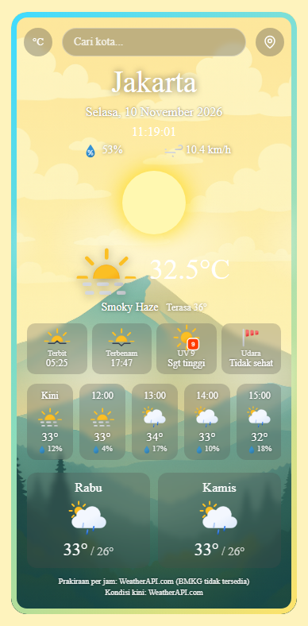
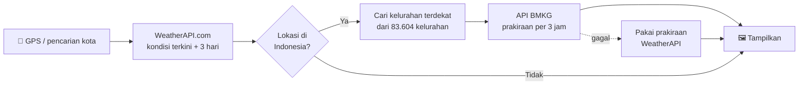

<div align="center">


# Cuy Cuaca

**Aplikasi cuaca ringan yang tahu kamu ada di kelurahan mana.**

Kondisi cuaca terkini, prakiraan per jam, dan prakiraan harian, dengan data resmi **BMKG** untuk seluruh Indonesia.




</div>

---

## ✨ Fitur

| | Fitur | Keterangan |
|:-:|---|---|
| 📍 | **Lokasi otomatis** | Minta izin lokasi saat dibuka. Kalau ditolak, langsung tampil cuaca Jakarta. |
| 🇮🇩 | **Prakiraan BMKG** | Untuk lokasi di Indonesia, prakiraan diambil dari BMKG sampai tingkat **kelurahan/desa**. |
| 🔎 | **Cari kota** | Saran kota muncul saat mengetik, bisa dipilih dengan mouse atau tombol panah ↑ ↓. |
| 🕒 | **Jam live** | Tanggal dan jam berjalan mengikuti zona waktu kota yang ditampilkan. |
| ⏱️ | **Prakiraan per jam** | 24 jam ke depan (WeatherAPI) atau per 3 jam (BMKG), lengkap dengan peluang/curah hujan. |
| 📅 | **Prakiraan harian** | Suhu maksimum & minimum untuk hari-hari berikutnya. |
| ☀️ | **Detail lengkap** | Matahari terbit & terbenam, indeks UV, kualitas udara, kelembapan, angin, dan suhu "terasa". |
| 🌡️ | **°C ⇄ °F** | Ganti satuan suhu dengan satu klik, pilihan tersimpan otomatis. |
| 🌧️ | **Animasi cuaca** | Latar kartu ikut berubah: hujan, petir, salju, awan, kabut, siang & malam. |
| 🔄 | **Segar otomatis** | Data diperbarui tiap 10 menit, kota terakhir diingat untuk kunjungan berikutnya. |

## 🚀 Cara Menjalankan

Tidak perlu install apa pun. Cukup jalankan server statis di folder proyek:

```bash
git clone https://github.com/willsyh/WeatherApp.git
cd WeatherApp
python -m http.server 8000
```

Lalu buka **http://localhost:8000** di browser.

> [!TIP]
> Bisa juga pakai ekstensi **Live Server** di VS Code: klik kanan `index.html` → *Open with Live Server*.

> [!NOTE]
> Fitur lokasi otomatis hanya jalan di `localhost` atau situs HTTPS (aturan browser untuk Geolocation).

### 🔑 API key

Aplikasi memakai [WeatherAPI.com](https://www.weatherapi.com/) untuk kondisi terkini dan pencarian kota. Untuk memakai key sendiri (gratis), daftar di sana lalu ganti nilai `apiKey` di baris pertama [main.js](main.js):

```js
const apiKey = "API_KEY_KAMU";
```

## 🧠 Cara Kerja



1. **Kondisi terkini** (suhu, UV, kualitas udara, dll.) selalu diambil dari WeatherAPI.com.
2. Kalau lokasinya di Indonesia, koordinatnya dicocokkan ke **kelurahan terdekat** (maksimal 25 km) memakai data di [data/kelurahan/](data/kelurahan/). Data dimuat per provinsi, hanya provinsi yang relevan saja, jadi tetap ringan.
3. Kode kelurahan dipakai untuk mengambil **prakiraan BMKG**. Kalau BMKG sedang tidak bisa diakses, aplikasi otomatis kembali ke prakiraan WeatherAPI.
4. Sumber data yang dipakai selalu ditulis di bagian bawah kartu.

## 📁 Struktur Proyek

```
WeatherApp/
├── index.html                # Kerangka halaman
├── style.css                 # Tampilan, tema siang/malam, animasi cuaca
├── main.js                   # Semua logika aplikasi
├── assets/
│   ├── day-mountain.png      # Latar siang
│   ├── night-mountain.png    # Latar malam
│   └── icons/                # Ikon cuaca animasi (Meteocons)
├── data/kelurahan/
│   ├── index.js              # Batas koordinat tiap provinsi
│   └── 11.js … 96.js         # Daftar kelurahan + titik koordinat per provinsi
└── scripts/
    └── build-kelurahan.py    # Pembuat ulang data kelurahan
```

### Memperbarui data kelurahan

Data kelurahan dibuat dari repo [wilayah_boundaries](https://github.com/cahyadsn/wilayah_boundaries). Untuk membuat ulang (butuh `git`, internet, dan mengunduh ±340 MB sekali):

```bash
python scripts/build-kelurahan.py
```

## 🙏 Kredit

- **Data cuaca:** [WeatherAPI.com](https://www.weatherapi.com/) dan [BMKG](https://data.bmkg.go.id/prakiraan-cuaca/) (Badan Meteorologi, Klimatologi, dan Geofisika)
- **Ikon cuaca:** [Meteocons](https://github.com/basmilius/weather-icons) oleh Bas Milius (MIT)
- **Data wilayah:** [wilayah_boundaries](https://github.com/cahyadsn/wilayah_boundaries) oleh Cahya DSN (MIT)

<div align="center">

---

Dibuat dengan ☕ dan sedikit gerimis oleh [@willsyh](https://github.com/willsyh)

</div>
